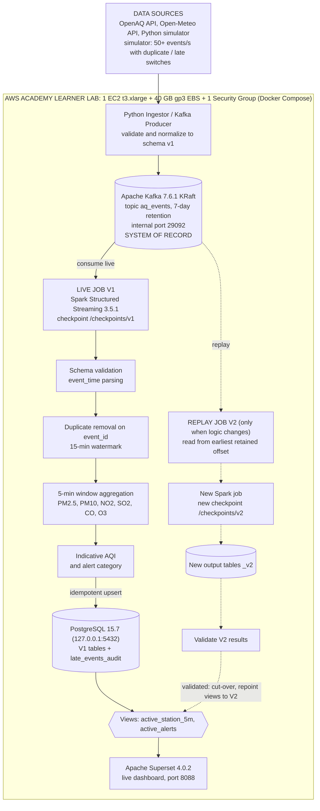

# Real-Time Air Quality Monitoring of Jaipur using Kappa Architecture

**Course:** Data Engineering — Lambda vs. Kappa Architecture
**Phase 1:** Architecture blueprint and technology decisions (due 30/10/2026)
**Architecture option:** **Option B — Kappa (single replayable log)**

## Team

| Name | Roll No. | Contribution (Phase 1) |
|------|----------|------------------------|
| Kunal Kasliwal | 2024BTech205 | Architecture diagram, Technology Decision Record, AWS resources and network/security design |
| Ashlesha Sharma | 2024BTech235 | Event contract and data sources, Kappa checklist (log sizing, late-data policy, reprocessing runbook) |

---

## 1. Project overview and problem statement

### Problem statement

Jaipur has only a few official air quality monitoring stations, and their readings reach users through different providers, in different formats and with different delays. Pollutant values such as PM2.5 and PM10 change within minutes, but the data is scattered, arrives late or out of order, and may contain duplicates or faulty sensor spikes. A citizen or analyst therefore has no single, consistent, near-real-time view of air quality across the city, and when the calculation rules change (for example the AQI method or sensor-spike filtering), old results cannot easily be recomputed.

**The problem we solve:** build a pipeline that ingests Jaipur air quality readings continuously, handles duplicate, late and out-of-order events correctly, produces live per-station window averages and an indicative AQI, and can recompute all results from history when the logic changes.

### Project overview

This project builds one streaming pipeline that ingests the readings, normalizes them into a common schema, stores **100% of events in a replayable Kafka log**, computes **event-time window averages and an indicative AQI** with Spark Structured Streaming, serves the results from PostgreSQL, and shows them on a live Superset dashboard.

Kappa is used because there is a single processing path: when the logic changes, the log is replayed through a new job version instead of maintaining separate batch code. There is no S3 path and no batch layer.

---

## 2. Data sources and common event contract

| Source | Data | Role |
|--------|------|------|
| OpenAQ API v3 | Real readings from Jaipur monitoring stations (PM2.5, PM10, NO₂, SO₂, CO, O₃) | Real data, polled by the ingestor |
| Open-Meteo Air Quality + Weather API | Hourly pollutant and weather values for Jaipur coordinates | Second real source |
| Python simulator | Virtual sensors across Jaipur zones, default **≥ 50 events/s**, switches for **duplicate**, **late** and **out-of-order** events | Load and fault injection |

Real APIs give only a few records per station per hour, so the simulator provides the 50 events/s rate. Every event carries `source_type` (`openaq`, `open_meteo`, `simulated`) so simulated data is never presented as real. Exact Jaipur station IDs will be confirmed from OpenAQ in Phase 2.

**Event contract (schema v1):**

| Field | Type | Meaning |
|-------|------|---------|
| `event_id` | string | **Unique event ID.** Deterministic hash of `source_type + station_id + event_time + values`, so a re-polled reading gets the same ID. |
| `event_time` | timestamp (UTC) | **When the measurement happened** (used for windows). |
| `ingest_time` | timestamp (UTC) | When the event was produced to Kafka (used to measure lateness). |
| `station_id` | string | **Entity key** (station or virtual sensor); also the Kafka message key. |
| `zone`, `lat`, `lon` | string, double | Location in Jaipur. |
| `source_type` | string | `openaq` / `open_meteo` / `simulated`. |
| `pm25`, `pm10`, `no2`, `so2`, `o3`, `co` | double | **Numeric measures** (µg/m³; CO in mg/m³). Missing = `null`. |
| `temperature_c`, `humidity_pct` | double | Optional weather measures. |
| `schema_version` | int | `1`. |

Events with negative values or no pollutant at all are rejected at ingestion and logged, not sent to Kafka.

---

## 3. Architecture diagram

**Flow:** the sources feed the ingestor, which publishes 100% of events to Kafka (the system of record). The live Spark job (V1) reads Kafka, validates, removes duplicates, aggregates in event-time windows, computes the AQI and writes to PostgreSQL. Superset reads only the `active_*` views. When logic changes, a second Spark job (V2) replays Kafka from the earliest retained record with its own checkpoint and output tables; after validation the views are repointed to V2 (dotted path).

### Ports and network security

| Port | Service | Exposure |
|------|---------|----------|
| 22 | SSH | Security Group: own public IP `/32` only |
| 8088 | Superset | Security Group: own public IP `/32` only |
| 9092 | Kafka external listener | Closed (producers run inside the instance) |
| 29092 | Kafka internal listener | Docker network only |
| 5432 | PostgreSQL | `127.0.0.1` only, reach via SSH tunnel |
| 8080 / 8081 | Spark master / worker UI | `127.0.0.1` only, reach via SSH tunnel |

Secrets are kept in `.env` (listed in `.gitignore`; only `.env.example` is committed). All images and libraries are pinned, no `latest`.

---

## 4. AWS resources used (minimal) and their purpose

| AWS resource | Qty | Purpose | Justification |
|--------------|-----|---------|---------------|
| EC2 instance, Ubuntu, **t3.xlarge** (4 vCPU, 16 GB RAM) | 1 | Runs all containers: Kafka, Spark, PostgreSQL, Superset, ingestor, simulator | The assignment requires everything on one instance. Kafka, Spark (master, worker, jobs), PostgreSQL and Superset together need roughly 10 to 12 GB RAM (assumption), and Spark replay runs next to the live job, so 8 GB would be too tight. 16 GB is also the recommended size. |
| EBS volume **gp3, 40 GB** | 1 | Disk for the 7-day Kafka log, Spark checkpoints, PostgreSQL data, Docker images | Sizing in section 6.1 shows 30 GB is too tight in the pessimistic case, so 40 GB. gp3 is the required type and is cheap per GB. |
| Security Group | 1 | Firewall: inbound SSH 22 and Superset 8088 from our own `/32` IP only | Required by the guidelines; keeps Kafka, PostgreSQL and Spark UIs unreachable from the internet. |
| Key pair | 1 | SSH access (private key never committed) | Needed to log in to EC2 securely. |
| Default VPC / subnet | existing | Network for the instance | Reused, so no extra networking resource or cost. |

**Not used:** S3, Athena, Glue, RDS, MSK, Kinesis, ECS/EKS, Elastic IP, second EC2. Kappa has no S3 or batch layer, and Kafka and PostgreSQL run in containers on the same instance. After each restart we update `EC2_PUBLIC_IP` in `.env` and the Security Group rule. The instance is stopped when not in use to stay well under the $100 credit limit.

---

## 5. Technology Decision Record

| Layer | Decision (pinned) | Why | Alternative considered | Trade-off |
|-------|-------------------|-----|------------------------|-----------|
| Host / deployment | AWS Learner Lab, 1 × EC2 t3.xlarge, 40 GB gp3, Docker Compose | Single-instance requirement; reproducible with `docker compose up -d` | ECS/EKS, multiple EC2 | Single point of failure; EBS billed while stopped |
| Language | Python 3.11 (generator, ingestor, PySpark), SQL | One language for all components; PySpark supports Structured Streaming | Scala, Java | Python is slower; use built-in Spark functions |
| Message log | **Kafka KRaft `confluentinc/cp-kafka:7.6.1`**, topic `aq_events`, 3 partitions, RF 1, `retention.ms=604800000` | Durable, ordered per key, replay from earliest offset, no ZooKeeper | Redpanda, Pulsar | Single broker, no HA; retention is deletion-based |
| Stream processing | **Spark Structured Streaming `apache/spark:3.5.1`** (standalone, 1 master + 1 worker) | Event-time windows, watermark, `dropDuplicatesWithinWatermark`, checkpoint recovery | Flink, Kafka Streams | Micro-batch latency of seconds; replay shares RAM/CPU |
| Serving store | **PostgreSQL `15.7`**, versioned tables + views | `ON CONFLICT` upserts, transactional view swap for cut-over | ClickHouse, TimescaleDB | Single node, no managed backup |
| BI / dashboard | **Apache Superset `4.0.2`** (+ `psycopg2-binary`) | Auto-refresh, native PostgreSQL support, dashboard export | Grafana, Metabase | Heavier image; queries must be bounded |
| Reprocessing | Separate checkpoint dirs, `_v1`/`_v2` tables, `active_*` views | Safe parallel replay, instant cut-over and rollback | Overwrite tables in place | More CPU/RAM while V1 and V2 run together |

---

### Why both Kafka and Spark Structured Streaming are used

They do two different jobs, and a Kappa pipeline needs both.

| | Apache Kafka | Spark Structured Streaming |
|---|---|---|
| **Role** | Storage: the replayable **log** and system of record | Compute: the **processing engine** |
| **What it does** | Keeps every event for 7 days, ordered per station, and lets any consumer re-read from the earliest offset | Event-time windows, watermark, duplicate removal, AQI calculation, checkpointed state |
| **What it cannot do** | Cannot window, deduplicate or compute AQI | Cannot store history for replay; it only reads what the log retains |

- **Without Kafka:** there would be no durable history, so a V2 job could not re-read old events and the Kappa reprocessing requirement would fail.
- **Without Spark:** the events would be stored but never turned into windows, AQI or alerts for the dashboard.
- **Together:** Kafka keeps the data, Spark computes on it, and reprocessing is simply "start another Spark job that reads Kafka from the beginning".

## 6. Kappa checklist

### 6.1 Log sizing (7-day retention)

`disk = event rate × average event size × retention seconds`, plus a margin.

- Retention: 7 × 24 × 3600 = **604,800 s**
- Rate: **50 events/s** (default; real feeds add very little)
- Events retained: 50 × 604,800 = **30,240,000**

| Avg event size *(assumption)* | Raw | With 30% margin |
|-------------------------------|-----|-----------------|
| 350 B (expected JSON size) | 10.58 GB | **13.76 GB** |
| 500 B (pessimistic) | 15.12 GB | **19.66 GB** |
| 1,000 B (very pessimistic) | 30.24 GB | 39.31 GB |

Docker images, PostgreSQL, checkpoints and OS need about 10 GB more. In the expected case (13.76 + ~10 ≈ 24 GB) 30 GB would fit, but in the 500 B case (19.66 + ~10 ≈ 30 GB) it is too tight, so we choose **40 GB gp3**. Producer compression (lz4/snappy) may reduce the size further. Real event size and rate will be measured in Phase 2.

### 6.2 Late data policy

Air quality data is naturally late (API readings often arrive 10–60 minutes after measurement), and the simulator injects delays on demand.

| Policy | Choice |
|--------|--------|
| Time basis | `event_time`, never ingestion time |
| Window | **5-minute tumbling** window per `station_id` (avg/min/max/count per pollutant); hourly roll-up for the indicative AQI |
| Watermark | **15 minutes** (`withWatermark("event_time", "15 minutes")`). Covers typical delays without keeping too much state. |
| Duplicates | `dropDuplicatesWithinWatermark(["event_id"])` in Spark, plus primary key `(station_id, window_start, rule_version)` and `ON CONFLICT DO UPDATE` in PostgreSQL |
| Output | `update` mode with `foreachBatch` upsert, so refined windows replace old rows without duplicates |
| **Events later than the watermark** | Not applied to already-finalized live windows. They are written to `late_events_audit` (event_id, station, event_time, ingest_time, delay) so they are counted, and they stay in Kafka until retention expires, so a V2 replay can include them. Events older than 7 days cannot be recovered. |
| Restart recovery | Spark checkpoint on EBS (offsets + state), `restart: unless-stopped` |

The indicative AQI uses Indian National AQI category bands (Good to Severe) on window averages. This is an approximation of the official CPCB method, which uses 24-hour averages for PM.

### 6.3 Reprocessing runbook

*Example reason:* V1 averages all readings; V2 adds an outlier filter for implausible sensor spikes and a corrected AQI calculation, so old results must be recomputed from the log.

| Step | Action |
|------|--------|
| 0 | Confirm V1 is running and the dashboard reads `active_*` = V1 tables (`rule_version = 1`). |
| 1 | Check the earliest retained offset: `kafka-run-class kafka.tools.GetOffsetShell --broker-list kafka:29092 --topic aq_events --time -2` |
| 2 | Create the V2 tables `aq_station_5m_v2`, `aq_alerts_v2`. V1 tables are not touched. |
| 3 | Start `stream_job_v2.py` as a **separate Spark application** with `rule_version = 2`, **its own checkpoint** `/opt/checkpoints/v2`, `startingOffsets = earliest`, and limited cores so V1 keeps running. |
| 4 | Wait until V2 **catches up** (consumer lag close to zero against the topic end offsets). |
| 5 | **Validate V2:** row counts and time coverage; known simulator test windows give expected averages; duplicate-injection run gives 0 duplicate rows; late events within 15 min are counted and those beyond go to `late_events_audit`; manually check 5–10 AQI values. |
| 6 | **Cut-over** in one transaction: `BEGIN; CREATE OR REPLACE VIEW active_station_5m AS SELECT * FROM aq_station_5m_v2; CREATE OR REPLACE VIEW active_alerts AS SELECT * FROM aq_alerts_v2; COMMIT;` Superset shows V2 with no dashboard change. |
| 7 | Stop the V1 job; keep `_v1` tables for rollback. |
| 8 | **Rollback if needed:** repoint the views to `_v1` using the same transaction. |

Replay is only possible within the 7-day retained window.
